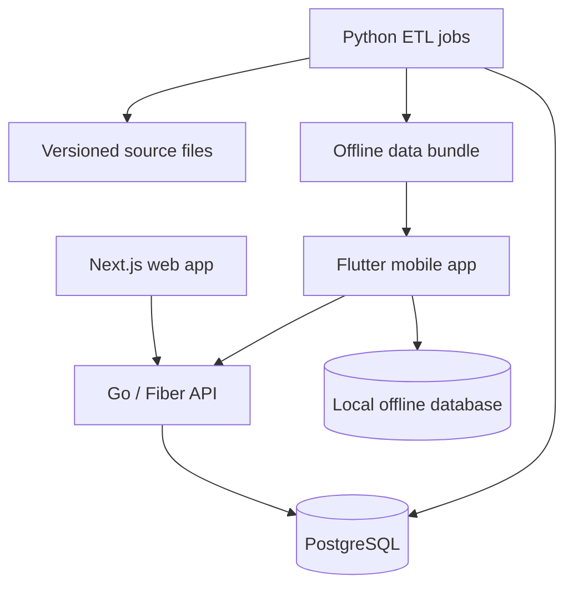

# Architecture

## 1. System overview

## 2. Logical domains

### Quran Core
Canonical identifiers and text records for surahs, ayahs, and words. Keep source identifiers and mappings where possible.

### Mushaf Layout
Edition-specific pages, lines, ordering, glyphs, and geometry/hit-test data. Layout is edition-specific; never treat it as universal Quran text structure.

### Linguistics
Roots, lemmas, morphology, POS, translations, and word-to-annotation links. Every annotation should retain source and version.

### Reader state
Bookmarks and reading progress. User state is separate from imported Quran data.

## 3. Runtime

- **Next.js (Web, online-first):** consumes Go/Fiber API (SSR/client fetch with HTTP caching) and renders fixed page/line composition via DOM + web fonts (`@font-face`). Built first to validate data and UX end-to-end.
- **Flutter (Mobile, offline-first):** displays page and line data from local storage.
- A page renderer scales a fixed page surface; it does not use ordinary paragraph wrapping.
- Selection/hit-testing maps a tap to a layout item and then to a word identifier.
- Local DB serves core reading and word-detail data offline.
- Split local SQLite storage into two databases:
  - `mushaf_bundle.db` (read-only): Quran core, Mushaf layout, translations, morphology, and search indexes; updated via atomic file swap/rollback.
  - `user_state.db` (read-write): bookmarks and reading progress; preserved independently across bundle updates.
- API provides metadata, updates, optional sync, and search fallback.
- PostgreSQL is the canonical backend database.
- Python ETL imports and validates versioned source datasets.

## 4. Renderer options

1. **Mapped glyph/page-font renderer:** preferred if source mapping and font support reliable glyph identity and selection geometry.
2. **Fixed-line composition:** compose word runs per line; needs careful Arabic shaping and visual QA.
3. **Hybrid:** use source page/glyph layout and overlays for selection if geometry is available.

Choose only after M0 proof. Do not assume source data contains bounding boxes; inspect it.

## 5. Deployment

- API service stateless, containerized.
- PostgreSQL managed or self-hosted with backups and migration management.
- ETL execution isolated from API runtime.
- Store immutable source snapshots and checksums in controlled storage.
- Version offline bundles; use atomic update/rollback strategy.

## 6. Observability and security

- Structured logs and request IDs.
- API rate limits and health endpoints.
- Secrets kept out of repository.
- Read-only Quran dataset API access except user-state endpoints.
- Backups and restore drills.
- Track ETL run, source checksum, and validation report.
